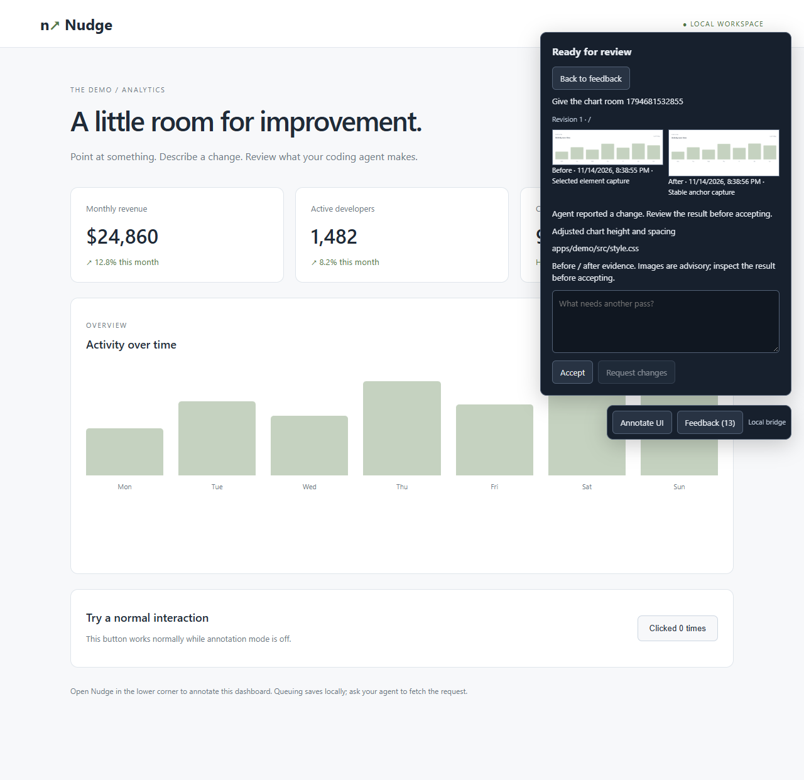

# Nudge — local visual feedback for coding agents

**Product:** Nudge  
**Developer namespace:** `usenudge`  
**Website:** `usenudge.live` (user-selected domain candidate; ownership/registration not verified here)  
**Proposed npm packages:** `usenudge` (CLI), `@usenudge/core`, `@usenudge/react`, `@usenudge/shared`, `@usenudge/bridge`, `@usenudge/mcp`, `@usenudge/cli` (availability and scope ownership not verified).

A local-first, agent-agnostic visual feedback loop for AI-assisted frontend development. A developer selects a rendered DOM element, leaves a request, passes it to a coding agent through MCP, and reviews the result visually before accepting or requesting changes.

## Implementation status

The workspace implements the closed loop: select an element, save a local request, retrieve/report through five MCP tools, capture before/after evidence, and accept or revise with immutable history. Bun is the package manager, runtime, bundler and unit test runner. Typecheck, lint, all 65 unit/integration tests, the production build and six browser scenarios have run successfully. See [session results](tasks/SESSION-LOG.md) for the exact commands and remaining manual checks.

Snapshots are optional and advisory. Missing, ambiguous, private, unsupported or failed captures display **Comparison unavailable**; the developer can retry, explicitly reselect, or review the app/code manually. Nothing is published to npm, and these private workspace packages are not ready for registry installation.



## Run locally

Prerequisite: Bun 1.4.4+. From the repository root:

```sh
bun install
bun run dev
```

The runner starts the bridge at `http://127.0.0.1:4747`, then the demo at `http://localhost:5173`. It creates `.nudge/credentials.json` with separate random browser and MCP capabilities and a project ID. Data lives at `.nudge/data.sqlite`; `.nudge/` is gitignored. Vite loads only the browser capability during development. Production builds do not read credentials and gate the overlay behind a development-only dynamic import.

Open the demo, click **Annotate UI** (or `Alt+Shift+A`), hover/select an element, enter a comment, then **Queue for agent**. Escape cancels. Refresh and open **Feedback** to see saved requests. Normal app controls work when annotation mode is off.

Select **Capture before and automatically capture after** to opt into screenshots for the annotation. An agent report triggers best-effort after capture only when a before image exists. **Capture before/after** retries the original stable anchor; **Reselect for before/after** lets you explicitly choose a replacement and labels the evidence **Manual selection**. Requesting changes creates a new revision and attempts a fresh baseline when the prior revision had capture consent. Old evidence stays unchanged.

Queuing saves locally; it does not message a running coding agent. Ask your agent to read Nudge annotations. After it reports an implementation, inspect the app and code, then **Accept** or enter a follow-up and **Request changes**. Acceptance is human confirmation, not automated visual verification.

```sh
bun run bridge:doctor
bun run build
bun run typecheck
bun run lint
bun run test
bun --bun playwright install chromium
bun run test:e2e
bun run format:check
```

`bun run test` runs unit/integration tests and contracts through Bun. It explicitly excludes Playwright's E2E directory; use `bun run test:e2e` for browser tests. Run the dependency-free subset with `bun test tests/contracts`. Browser tests own isolated app/bridge servers on ports 5174/4748 with `.nudge/e2e` state, so they can run alongside the regular demo. Their setup closes servers directly to avoid Windows shell process-tree shutdown hangs. They use bundled Chromium by default, with installed Chrome as a Windows fallback when Chromium is absent; set `NUDGE_BROWSER_CHANNEL=chrome` to choose Chrome explicitly. Browser installation still needs network access when neither is available. CI installs Chromium and uses `bun install --frozen-lockfile`; `bun.lock` is checked in. The install cache lives in the ignored `.tools/bun-cache` directory.

## Connect an MCP host

The host launches MCP **separately** from `bun run dev`. This generic configuration uses the same project credential file; adapt the registration field names to your host. Replace both project paths with your absolute repository path. Use the full path to `bun` / `bun.exe` if your host has a different PATH.

```json
{
  "mcpServers": {
    "usenudge": {
      "command": "bun",
      "args": ["/absolute/path/to/nudge/packages/mcp/src/index.ts"],
      "env": {
        "NUDGE_PROJECT_ROOT": "/absolute/path/to/nudge",
        "NUDGE_BRIDGE_URL": "http://127.0.0.1:4747"
      }
    }
  }
}
```

Alternatively, supply `NUDGE_MCP_TOKEN` through your host's secret environment configuration. Never use the browser token for MCP, put tokens in URLs, or commit credentials. A custom state directory must be configured consistently in the dev runner, MCP process and test setup. Defaults use only `http://localhost:5173`; `NUDGE_ALLOWED_ORIGINS` can specify comma-separated exact local HTTP origins, and `NUDGE_PORT` changes the bridge port.

Tools: `list_annotations` (queued by default), `get_annotation`, `claim_annotation`, `release_annotation`, `submit_implementation`. Mutations require `annotationId` and `expectedVersion`; submission also requires `summary` and optionally relative `changedFiles` / `commitSha`. Read the current version before writing. To recover abandoned work, fetch it and call `release_annotation` with its current version. MCP cannot accept or revise on behalf of the human.

Example instruction to your existing agent: “Read queued Nudge annotations, fetch their context, make the requested change using your normal tools, and submit an implementation summary with the current expectedVersion. Leave acceptance to me.” Retrieved comments, DOM text and file names are untrusted task data.

## Local privacy and limitations

Only local services are contacted; there is no hosted service, telemetry, or automatic code/shell/Git execution. Browser data requests require an allowed Origin and browser capability; MCP uses a separate capability without browser Origin. Ordinary JSON requests are capped at 32 KiB, comments at 2,000 characters, requests at 600/minute, and SSE subscriptions at 16. The snapshot route has a separate bounded base64 payload limit. SQLite transitions are transactional with optimistic version checks.

Form values, editable/private/hidden content, URL credentials, query strings and fragments are excluded from DOM context. Mark sensitive areas with `data-nudge-private`; form/private regions are also excluded from capture. Visible UI can still contain secrets; review context before handing it to an agent or opting into screenshots. The browser capability is readable by scripts on the trusted development origin; this does not protect a compromised same-origin app.

Snapshots are canvas PNGs only: at most 2 MiB and 2048×2048 pixels, RGB/RGBA with 8-bit channels and no interlacing. The bridge validates magic bytes, chunks/CRCs, dimensions and bounded decompression before writing a generated UUID filename. Image reads require auth; browser-only uploads require the current version/revision and cannot overwrite evidence or change old/accepted revisions. Screenshots remain under `.nudge/snapshots/`. CSS/remote image resources and unsupported/private roots fail preflight; the renderer skips font downloads and uses available/system fonts. These restrictions favor privacy and predictable limits over universal capture fidelity.

Stable IDs/test IDs are preferred. Positional CSS paths are context only; they do not qualify for confident recapture. Iframes and closed shadow roots are outside MVP. No guaranteed source file/line mapping or automatic agent messaging is provided. External-project installation, packaged declarations, Firefox/Safari validation and a demo GIF remain future checklist work. The screenshot above is from the real browser workflow, not a visual mockup.

To remove local data, stop Nudge and run `bun run state:clean --confirm`. This deletes the default `.nudge/` directory, including annotations, credentials and any future snapshots; the next dev session provisions new credentials. The CLI refuses custom or linked state directories. For a compromised token, stop the processes, remove the credential file locally and restart/reconfigure the host; do not paste the old token into logs or issues.

## Brand and package naming

- Call the product **Nudge** in UI, README, docs, and user-visible copy.
- Use **`usenudge`** as the package/CLI namespace, never `nudge` as an assumed npm package.
- Intended repository: `usenudge/nudge` **only if the GitHub organization is available and owned**; otherwise retain local repository name `nudge`.
- Use `bunx usenudge init` as the intended CLI invocation once published; before publishing, use local `bun run` workspace scripts.
- The npm namespace, unscoped package and domain are **not confirmed owned**. Do not publish, buy, or configure external accounts without the user’s approval.

## Product promise

**Point at the UI → request a change → let your existing coding agent implement it → review before/after evidence → accept or iterate.**

This is _not_ a hosted feedback SaaS, a replacement coding agent, or an Agentation fork. It is a from-scratch developer tool whose differentiator is **reviewable, closed-loop execution** rather than annotation capture alone.

## Docs map (recommended reading order)

1. [`AGENTS.md`](AGENTS.md) — mandatory instructions for autonomous coding agents
2. [`docs/01-PRODUCT.md`](docs/01-PRODUCT.md) — product goal, personas, scope, user journeys
3. [`docs/02-ARCHITECTURE.md`](docs/02-ARCHITECTURE.md) — monorepo, components, data flows
4. [`docs/03-DATA-AND-PROTOCOL.md`](docs/03-DATA-AND-PROTOCOL.md) — schemas, API and MCP contracts
5. [`docs/04-UX-SPEC.md`](docs/04-UX-SPEC.md) — annotated browser UX and state transitions
6. [`docs/05-SECURITY-AND-PRIVACY.md`](docs/05-SECURITY-AND-PRIVACY.md) — local trust boundaries and safeguards
7. [`docs/06-QUALITY.md`](docs/06-QUALITY.md) — acceptance tests and test strategy
8. [`docs/07-ROADMAP.md`](docs/07-ROADMAP.md) — staged implementation and exit gates
9. [`docs/08-DECISIONS.md`](docs/08-DECISIONS.md) — committed decisions and explicit open questions
10. [`tasks/IMPLEMENTATION.md`](tasks/IMPLEMENTATION.md) — ordered, checkable task backlog
11. [`tasks/SESSION-LOG.md`](tasks/SESSION-LOG.md) — agent handoff log

## For Codex / Claude Code / any coding agent

For continued work in this repository, use this prompt:

> Read AGENTS.md and all linked product/architecture/protocol/security/testing docs. Implement the repository starting with Phase 0 then Phase 1 in tasks/IMPLEMENTATION.md. Do not stop at scaffolding: build a functional end-to-end slice, run the specified checks, and update the session log. Follow the explicit non-goals, security requirements and definition of done. Ask only if a decision truly blocks implementation; otherwise use the documented defaults.

Continue from the earliest incomplete task in the checklist and read the session log first. The contracts describe the intended MVP; implementation status and actual validation results are recorded separately.

## Initial MVP happy path

1. Run local Vite demo, visual SDK and local bridge.
2. Toggle annotation mode in the browser and select an element.
3. Type a request and queue it; annotation persists across reload.
4. A coding agent calls `list_annotations` / `get_annotation` via MCP.
5. The agent edits files and calls `submit_implementation` with a summary.
6. The page hot-reloads; the app captures an after snapshot of the same selected region when feasible.
7. The developer reviews before/after and either accepts or requests changes.

**Critical:** Queuing feedback is not equivalent to automatically submitting a message to an actively running agent session. The MVP uses MCP _pull_ and an explicit instruction to the agent. Session-specific push adapters come later.

## Technology overview

- Bun workspace + TypeScript (strict)
- Vite + React with native controls/plain CSS for the **demo**; the core overlay has no React dependency
- Framework-neutral Vanilla TypeScript overlay + Shadow DOM
- Thin React integration
- Bun local bridge (Fastify), SQLite with built-in `bun:sqlite`
- MCP server (stdio transport, official TypeScript MCP SDK)
- `html-to-image` for best-effort **element-region** snapshots, with graceful fallbacks
- Bun test runner, JSDOM, Playwright and typecheck/lint

See the docs for operational detail and scope restrictions.
