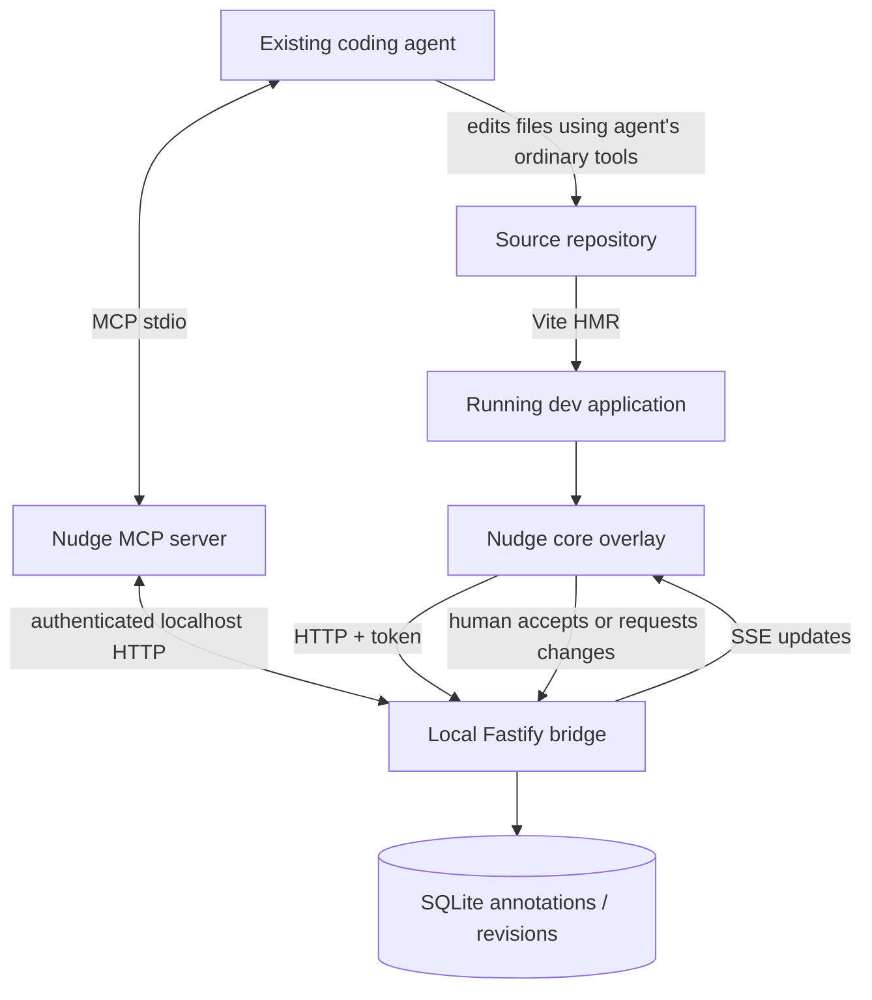

# 02 — Architecture and tech stack

## Decision summary

TypeScript monorepo with Bun as package manager and runtime, no Python service in MVP: local workflow needs a lightweight bridge near JS tooling. Keep packages separated so a future hosted Python/FastAPI backend could consume the same shared protocol without rewriting the browser SDK.

## Monorepo

```text
nudge/
  AGENTS.md
  README.md
  docs/
  tasks/
  apps/demo/               # Vite + React + demo pages, playground
  packages/shared/         # Zod schemas, DTOs, constants, protocol
  packages/core/           # vanilla TS DOM overlay, anchor and capture
  packages/react/          # dev-only React convenience component
  packages/bridge/         # Fastify HTTP/SSE + SQLite repository
  packages/mcp/            # stdio MCP server; bridge HTTP client
  packages/cli/            # optional local dev UX
  bun.lock                 # generated by the first successful bun install
  package.json             # Bun workspaces
  tsconfig.base.json
```

### Intended package names

| Workspace         | Package name (provisional until npm ownership is confirmed) |
| ----------------- | ----------------------------------------------------------- |
| `packages/shared` | `@usenudge/shared`                                          |
| `packages/core`   | `@usenudge/core`                                            |
| `packages/react`  | `@usenudge/react`                                           |
| `packages/bridge` | `@usenudge/bridge`                                          |
| `packages/mcp`    | `@usenudge/mcp`                                             |
| `packages/cli`    | `@usenudge/cli`                                             |

If an npm name is unavailable, keep local workspace naming and seek user approval before adopting a public alternative. Do not publish as part of MVP work.

### Dependencies

- `shared`: Zod; no browser or Node-only dependencies.
- `core` → `shared`: DOM overlay and `html-to-image` optional lazy import for snapshots.
- `react` → `core`: lifecycle wrapper, React as peer dependency.
- `bridge` → `shared`: Fastify, built-in `bun:sqlite`, SSE endpoint, local disk only.
- `mcp` → `shared`: official MCP TypeScript SDK, authenticated local HTTP client.
- `demo` → `react` (or core SDK directly for testing) and dev bridge.

Keep payload type contracts independent of storage implementation.

## Processes

- **Dev app** (example `http://localhost:5173`): product being edited, with overlay SDK mounted in dev.
- **Bridge** (`http://127.0.0.1:4747` by default): stores annotation records and pushes state events via SSE.
- **MCP stdio subprocess:** launched by each coding-agent host; uses configured bridge URL and token to read and update the same records. It **does not** launch or control the agent.

### High-level data flow



## Overlay implementation

- Mount a fixed-position host element under `document.body` and attach a **closed or open Shadow Root** (open is acceptable for dev diagnostics; choose open for MVP).
- Use a single pointermove listener (throttled with `requestAnimationFrame`) and `document.elementFromPoint()`; ignore overlay's own host and internal elements.
- Use an isolated selection layer with `pointer-events: none` for outlines, but make annotation-mode interception explicit and reversible.
- Use `getBoundingClientRect()` and recompute on scroll, resize and relevant layout changes (ResizeObserver or small explicit observer).
- `Escape` cancels selection; overlay disable tears down listeners, observers and timers.
- Element anchoring stores durable attributes and a safe selector; never trust only DOM index or coordinates.
- Snapshots: lazy-load `html-to-image` and attempt capture of selected element; persist small PNG/JPEG to a local bridge file store by upload or encoded API with explicit limits. Handle tainted canvas, fonts, cross-origin assets and unsupported nodes by showing **Snapshot unavailable**. Never require snapshot success to queue annotation.
- **Do not** capture the browser viewport using undocumented privilege or pretend canvas capture supports all pages.

## Persistence

- SQLite stored under an explicit project-scoped local state directory (e.g. `.nudge/data.sqlite`), excluded from Git.
- In MVP: `annotations`, `revisions`, `snapshots` metadata and optionally `events`; migration scripts must be deterministic.
- Snapshot binary blobs stored as files under `.nudge/snapshots/`, referenced by opaque IDs, with path traversal protection and a configurable size cap.
- Protect writes with transaction semantics and validated state transitions. Use UUIDs for external IDs.

## Source mapping strategy

**MVP:** DOM metadata (dataset/test ID, selector, trimmed nearby text, element role, URL and bounding box). This is enough to help an agent search code in many cases, but not a guaranteed file/line mapping.

**Later:** optional build-instrumentation plugin (Vite first) to insert dev-only source metadata; framework adapters for Astro/Vue/Svelte; React-specific development introspection only if stable/maintainable. Don't make source mapping a blocker for MVP.

## Local dev ergonomics

- Root `bun run dev` starts demo and bridge (e.g. `concurrently` / `turbo`); bridge prints its URL and how to configure token safely.
- Bridge should provision a random token on first boot and store it in a gitignored state/config file with restricted permissions where possible.
- Demo's SDK gets bridge URL and token via a **dev-only** Vite configuration. Because any token inside the browser is observable, token alone is not a protection against same-origin injected code: enforce origin restrictions and keep tool local; document trust assumption.
- CLI health check (`bun run bridge:doctor` is fine) verifies bridge reachable, auth working, persistence writable.
- MCP agent config example uses environment variables for local bridge URL and token; provide host-specific examples only after validation against current documentation.

## Reliability

- SSE reconnect with exponential backoff and local refetch; polling fallback acceptable.
- API validates every payload with Zod.
- Recover from invalid anchors without crashing.
- Do not pollute host CSS or event propagation outside annotation mode.
- Ensure hot-reload unmount/re-mount doesn't leave duplicate overlays.
