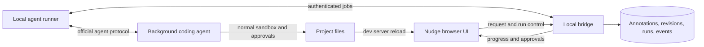

# 09 — Nudge-managed agent sessions

## Product correction

The user clarified that the central vision is to request, run and review a UI
change inside Nudge without operating a separate coding-agent terminal or app.
This is the primary workflow, not an optional convenience after the MCP queue.
The implemented queue/MCP loop is a foundation, but does not yet satisfy that
vision. The common ACP vertical slice for Codex, Claude and OpenCode is implemented with deterministic process and
browser coverage. Live provider validation remains open: app-server cannot open
its SQLite state under the user profile in this restricted environment.

## Primary experience

Current setup foundation: the CLI detects Codex/Claude, checks their local login
status, guides missing-install/login steps and writes explicitly selected
project MCP configuration. This connects external sessions only. In-UI model
selection remains future work. Preview Codex, Claude and OpenCode dispatch, durable
runs/sessions, supported approvals/questions, Stop and human review now exist.

1. Set up a supported local agent and select its model/permissions in Nudge.
   Reuse supported authentication and show real setup/sign-in requirements.
2. Select an element and describe the change. The composer defaults to **New
   session**. Open the compact session control only to select a compatible
   Nudge-managed session in this project, then choose **Run agent**.
3. Save the request and optional before capture, then create a durable run.
   Nudge starts a fresh background agent session in the configured project unless
   the user explicitly selected an existing session for this submission.
4. Show **Starting**, then **Working**, with an activity indicator and meaningful
   progress from real events. Display required permissions and agent questions
   inside Nudge rather than leaving a process waiting for terminal input.
5. Allow **Stop**. Cancellation prevents further work; it does not undo existing
   edits. Show failure, interruption and authentication-required states with a
   retry/setup path. Never spin indefinitely after a process exits.
6. An implementation report produces **Ready for review** and triggers the
   existing best-effort after capture. Process exit alone does not establish a
   successful implementation or visual correctness.
7. Accept or request another pass. Each follow-up also defaults to **New session**;
   the user can explicitly select an existing session. Create a new annotation
   revision without overwriting earlier evidence.

The queue remains an internal scheduling mechanism. Optional external MCP mode
can retain **Queue for agent** and explicit pull semantics. Managed mode must not
require manually asking another agent to fetch the request.

## Session selection and identity

Every submitted prompt defaults to a new agent session, including a prompt on a
newly selected element and a follow-up within an existing item. Do not silently
resume the last session, the item's original session, or a project-wide
conversation. Reset to **New session** for the next submission; continuation is
an explicit choice for that submission. The footer shows **New session** until
the user opens its disclosure and chooses a session. Explicit reuse changes the
footer to **Continue: session title**; busy sessions are labeled and disabled.

- **New session** — fresh provider conversation without another request's
  conversation history. Supply the selected element, current prompt and
  intentionally assembled annotation context as task data.
- **Existing session** — choose a compatible session in this project. Show its
  title/request excerpt, provider/model, recent activity and availability. Add
  the current element context and prompt as a new turn in that conversation.

A session can receive prompts about multiple selected elements/items. An item
can have runs in multiple sessions. Keep these identities separate:

| Record                | Meaning                                                                           |
| --------------------- | --------------------------------------------------------------------------------- |
| Annotation / revision | The element, request history and human review evidence.                           |
| Run                   | One submitted prompt's execution attempt, linked to its revision and one session. |
| Session               | The agent conversation containing one or more explicitly routed runs/turns.       |

Persist session mode and resolved session identity on each run, and display the
association in its detail view. Validate project/provider compatibility on the
server; an arbitrary provider session ID is not authorization. If a chosen
session is busy, missing or incompatible, explain the state and queue/disable or
offer an explicit new-session choice. Never silently switch sessions or mix
concurrent turns in one session. Runs on different requests may overlap (see
D-028), up to a per-project cap; fresh conversation context does not imply an
isolated source tree, so overlapping runs share the working copy. Provider process
lifecycle is an adapter detail; it must preserve conversation isolation.

## Architecture

- Add a separate `packages/runner` process, started by Nudge's local startup.
  It owns agent lifecycle. The browser and bridge do not execute shell commands.
- Give the runner a distinct capability. The browser submits validated IDs, not
  runner/provider credentials, executable paths, working directories or commands.
- Resolve project/executable settings from trusted local configuration. Use
  supported transports and argument arrays. Never interpolate comments, DOM
  text, selectors or model output into shell commands.
- Keep provider adapters independent. For Codex, prefer app-server for session
  reuse, streaming, approvals, questions and interruption. Verify installed APIs;
  do not assume every agent offers identical capabilities.
- Store run ID, revision ID, provider/session references, status, timestamps and
  bounded redacted activity separately from annotation status. Failed runs can
  retry without inventing a new accepted/rejected annotation state.
- Serialize editing runs per project initially. Use atomic claims and idempotent
  dispatch to prevent duplicate submission and competing edits. Reconcile
  interrupted work on restart; do not blindly repeat potentially completed edits.
- Preserve human-only acceptance and immutable snapshot/revision ownership.
- Create a session by default; resume only an explicitly selected, validated
  session. Dispatch idempotency includes session creation, so replaying a
  submission cannot launch extra agent instances.

## Permissions and privacy

The configured agent edits under its real sandbox and approval policies. Required
approval prompts reach the UI; do not bypass them to make background execution
appear seamless. Unknown approval requests fail closed. No automatic Git writes.

Local-first describes project state and execution location. Cloud-backed agents
can send context to their configured providers. Disclose this during agent setup;
do not promise zero egress while a cloud model is working. Keep credentials out
of browser bundles, screenshots and activity logs. Never stream unrestricted raw
process output to the browser.

## Acceptance gate

- After one-time setup, annotation → **Run agent** → implementation → visual
  review works without interacting with another agent terminal/app.
- Real run state survives refresh; distinguish work, approval waiting,
  completion, cancellation and failure. Respect reduced motion for indicators.
- Cover stop, unavailable provider, login requirements, denied approvals, failed
  checks, duplicate submission, restart and retry with behavioral tests.
- External MCP mode remains usable and honest about pull semantics.
- Default submissions, including follow-ups in one item, create distinct
  sessions. Explicit selection routes new element requests into the chosen
  session while keeping annotation/review histories separate.
- Test selection reset, cross-project/incompatible rejection, busy/missing
  sessions, no silent fallback, and idempotent session creation.
- Test deterministic provider fixtures, then validate an authenticated provider
  in the user's environment. Clearly distinguish fixture tests from a live run.

## Verified integration surfaces

- [Codex app-server](https://developers.openai.com/codex/app-server/) supports
  session lifecycle, streaming, approvals, questions and interruption. Installed
  `codex-cli 0.169.0` exposes app-server and protocol-generation commands. Only
  version/help were inspected; no live agent was launched. The CLI reported
  sandbox permission warnings for its user-profile temp directory.
- [Claude Code programmatic interface](https://code.claude.com/docs/en/headless)
  supports programmatic execution and structured streaming. Claude Code was not
  found on this shell's PATH; installation/authentication are not assumed.

Codex is the first adapter because it is installed in this environment. Its
generated 0.169.0 protocol was inspected. Claude and OpenCode preview adapters now
share the same run/session orchestration and deterministic browser acceptance
tests. The current implementation now uses a single ACP v1 client for all three
providers: maintained `@agentclientprotocol/codex-acp` and
`@agentclientprotocol/claude-agent-acp` adapters, plus native `opencode acp`.
The prior direct Codex app-server and Claude SDK implementations were removed.
The Claude ACP adapter still uses that SDK internally; Nudge no longer requires
apps to install it. CLI setup installs versioned adapters under ignored
`.nudge/agents/` or uses adapters already on PATH; installation never happens
inside a browser dispatch. The app manifest and lockfile are untouched.
Session/new/load, prompt, permission options, form elicitation and cancel are
handled by one shared protocol client. Native agent sign-in controls billing;
subscription and API-key authentication must not be confused. No credential
copying or direct inference calls are involved.
OpenCode's installed package metadata reports version 2.2.6; live startup is
blocked by the profile log path in this sandbox. No provider is claimed live-validated.
Enable with `usenudge agents --agent codex --managed`, then restart dev. The
runner inherits Codex model/sandbox/approval configuration; no permissive override
is applied. Unsupported permission requests and secret-input questions fail
closed. Runs have a 30-minute deadline and 30-second heartbeat expiry; restart
marks unfinished jobs interrupted rather than replaying edits.
